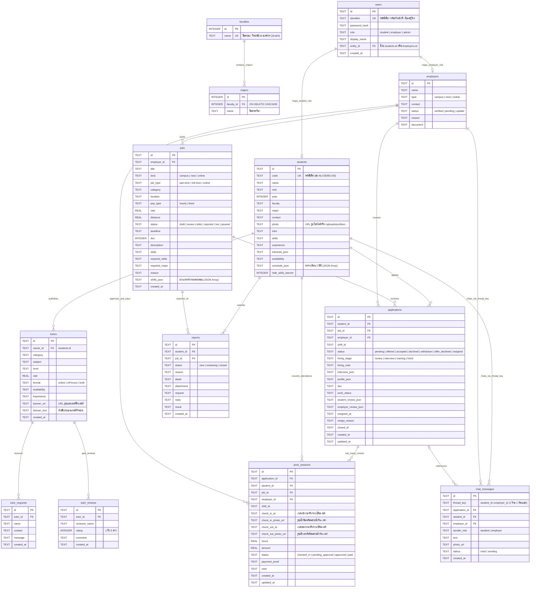

# HappiU — Entity-Relationship Diagram (ERD)

เอกสารแสดงโครงสร้างความสัมพันธ์ของฐานข้อมูล **HappiU v2.0 (SQLite)** ทั้ง **13 ตาราง + 3 SQL Views** อ้างอิงตรงจากไฟล์ Schema กลาง [server/schema.sql](file:///home/keng/Desktop/past-time/server/schema.sql)

---

## 1. แผนภาพความสัมพันธ์รวมทั้งระบบ (Full ERD)

---

## 2. สรุปความสัมพันธ์สำคัญ (Key Design Decisions)

| ความสัมพันธ์ | ประเภท | เหตุผลทางธุรกิจ (Business Rule) |
|---|---|---|
| `users` → `students` / `employers` | `1 : 0..1` | รองรับ **Unified Login** ช่องเดียว (รหัสนิสิต / รหัสเจ้าหน้าที่ / อีเมลผู้จ้าง) โดยไม่ต้องเลือกบทบาทตอนล็อกอิน |
| `applications` → `work_sessions` | `1 : N` | **1 งานที่รับเข้าทำ สามารถลงเวลาเข้า–ออกงานได้ไม่จำกัดรอบ** (ทำงานระยะยาวได้จริง) แม้รอบก่อนหน้าจะยัง `pending_approval` ก็เช็กอินรอบใหม่ได้ และหากนิสิตกด **แจ้งลาออก** (`resigned`) ประวัติ `work_sessions` และยอดเงินเดิมทั้งหมดยังคงอยู่ครบ |
| `students` + `employers` → `chat_messages` | `1 : N` (ผ่าน `thread_key`) | ใช้ `thread_key = student_id::employer_id` ทำให้ **1 นิสิต กับ 1 ร้าน มีห้องแชทเดียวเสมอ** แก้ปัญหาสมัครงานซ้ำแล้วระบบสร้างห้องแชทใหม่ซ้ำกับร้านเดิม |
| `students` → `tutors` → `tutor_reviews` / `tutor_requests` | `1 : N` | นิสิต 1 คนลงประกาศรับสอนได้หลายวิชา แก้ไข/ลบประกาศได้ (Cascade ลบคำขอและรีวิวที่ผูกกันออกด้วย) พร้อมเก็บรูป/คำอธิบายแบนเนอร์และรีวิวจากผู้เรียน |
| `employers` → `jobs` → `applications` | `1 : N` | ผู้จ้าง 1 ร้านลงได้หลายประกาศ แต่ละประกาศเก็บช่วงเวลาทำงาน (`shifts_json`) และประเภทงาน (`part-time`, `full-time`, `online`) เมื่อผู้จ้างอัปเดต `hiring_stage = 'hired'` ระบบซิงก์ `applications.status = 'accepted'` และผูก `shift_id` ทันที |

---

## 3. ดัชนีเพิ่มความเร็ว (8 Indexes) และ SQL Views (3 Views)
- `idx_jobs_employer_status` บน `jobs(employer_id, status)`
- `idx_apps_student` บน `applications(student_id, status)`
- `idx_apps_employer` บน `applications(employer_id, status)`
- `idx_chat_thread` บน `chat_messages(thread_key, created_at)` — โหลดประวัติแชทของแต่ละร้านได้เร็ว
- `idx_ws_app` บน `work_sessions(application_id, check_in_at DESC)` — ดึงประวัติรอบเช็กอิน–เช็กเอาต์ของงานแต่ละใบได้เร็ว
- `idx_ws_student` บน `work_sessions(student_id, status)` — คำนวณสรุปรายได้และชั่วโมงทำงานรวมของนิสิตได้เร็ว
- `idx_ws_employer` บน `work_sessions(employer_id, status)` — ดึงรายการรอรับรอง/รอโอนเงินฝั่งผู้จ้างได้เร็ว
- `idx_tutors_owner` บน `tutors(owner_id)`

### Views ที่สร้างไว้ใน `server/schema.sql`
- `v_login_accounts` — ดูบัญชีล็อกอินทุกบทบาทพร้อมคณะ/ประเภทผู้จ้าง
- `v_student_work_summary` — สรุปจำนวนรอบ, ชั่วโมงรวม และยอดเงิน (รอรับรอง / รับรองแล้ว / จ่ายแล้ว) รายงาน
- `v_job_overview` — ภาพรวมประกาศงานพร้อมชื่อร้านและจำนวนผู้สมัคร
